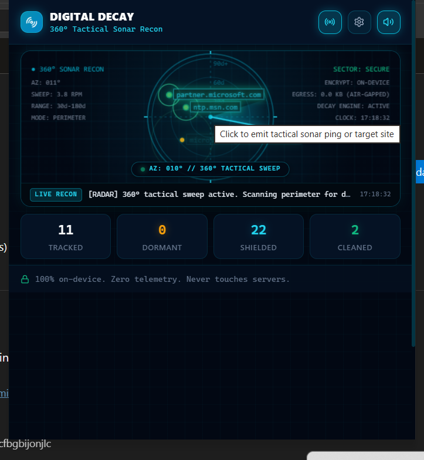
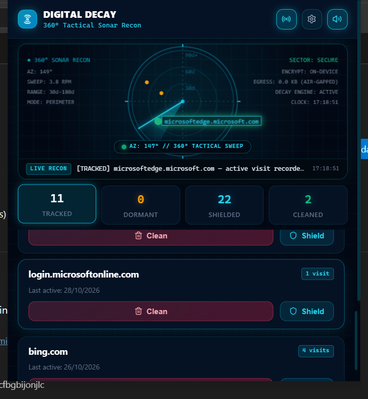
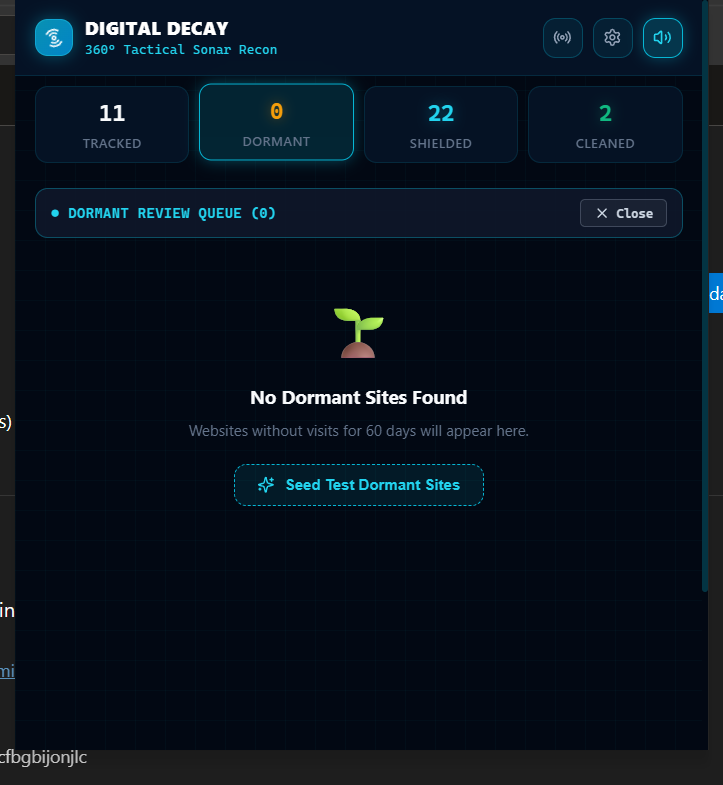
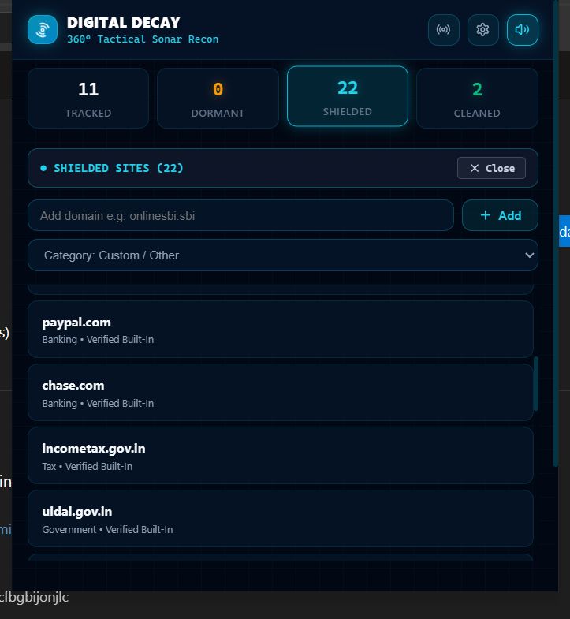
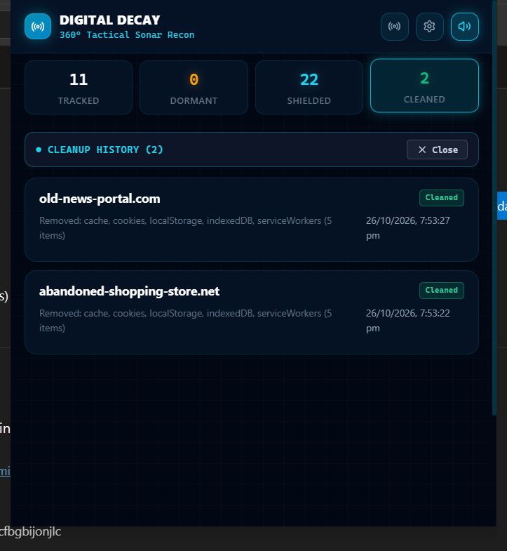

<p align="center">
  
</p>

<h1 align="center">Digital Decay</h1>

<p align="center">
  <strong>Open-Source Digital Footprint Pruner & Stale Session Invalidator</strong><br />
  <em>Proactively detect dormant web origins, enforce strict user consent for local browser data hygiene, force-terminate stale authentication sessions, and defend against infostealer token harvesting and global credential leaks.</em>
</p>

<p align="center">
  <a href="https://microsoftedge.microsoft.com/addons/detail/bmjlhndefgpcplihchoncfbgbijonjlc"><b>Microsoft Edge Add-on</b></a> •
  <a href="https://addons.mozilla.org/addon/digital-decay-tool/"><b>Firefox Add-on</b></a> •
  <a href="#-threat-context-global-data-leaks--dormant-sessions"><b>Breach Threat Analysis</b></a> •
  <a href="#-strict-user-consent-mandate-zero-surprise-actions"><b>User Consent Policy</b></a> •
  <a href="#-tactical-interface--feature-walkthrough"><b>Interface & Features</b></a> •
  <a href="#-privacy--honesty-guarantee-local-vs-remote-data"><b>Honesty Guarantee</b></a> •
  <a href="#-architecture--tech-stack"><b>Architecture</b></a> •
  <a href="#-getting-started"><b>Getting Started</b></a> •
  <a href="#-creator--lead-architect"><b>Author</b></a>
</p>

<p align="center">
  <!-- Security & Extension Store Badges -->
  <a href="https://microsoftedge.microsoft.com/addons/detail/bmjlhndefgpcplihchoncfbgbijonjlc"></a>
  <a href="https://addons.mozilla.org/addon/digital-decay-tool/"></a>
  
  
  
  
  
</p>

<p align="center">
  <!-- Development Badges -->
  <a href="LICENSE"></a>
  
  
  
  
  
</p>

> **Release Verification:** Release artifacts include cross-browser production packages (`digital-decay-chrome.zip` and `digital-decay-firefox.zip`), verified SHA-256 integrity checksums, and reproducible builds. See [Release Verification](#-release-verification).

---

## 🎯 Mission Overview

Every website you visit leaves behind persistent authentication cookies, local tokens, cached scripts, and background service workers. Over months of browsing, users accumulate **hundreds of dormant web origins** that they haven't touched in 30, 60, or 180+ days.

Standard browsers keep these sessions alive indefinitely. If an infostealer compromises your machine or a backend server leaks data, those forgotten sessions become immediate avenues for account takeover.

**Digital Decay** is an open-source, privacy-first browser extension engineered to:
1. **Map Inactive Origin Footprints**: Continuously track when you last interacted with web domains locally.
2. **Eliminate the Dormant Attack Vector**: Force-terminate stale sessions, purge authentication cookies, clear cache, and unregister background service workers for inactive sites.
3. **Enforce Strict User Consent**: Never perform silent or autonomous deletions. Digital Decay queues inactive sites, alerts you transparently, and requires explicit confirmation before wiping any origin.
4. **Visualize Local Perimeter Health**: Feature an interactive **360° Tactical Sonar Recon** radar that gives you situational awareness over dormant web origins.

---

## 🚨 Threat Context: Global Data Leaks & Dormant Sessions

The web security paradigm has fundamentally shifted. Attackers rarely spend weeks attempting to crack hashed passwords; instead, **they log in directly using stolen, unexpired session cookies and authorization tokens.**

```
+--------------------------------------------------------------------------------------------------+
|                                    THE STALE SESSION EXPOSURE CHAIN                              |
+--------------------------------------------------------------------------------------------------+
|                                                                                                  |
|   1. User Logs In Once          2. Inactivity Sprawl           3. Breach / Stealer Strike        |
|   [ Portal / SaaS / Bank ]  --> [ Untouched for 90+ Days ] --> [ PHP Exploit OR Infostealer ]    |
|   Session cookie granted        Browser stores session         Active cookie stolen from disk    |
|                                                                                                  |
|   4. Attack Result                                                                               |
|   --> Attacker bypasses MFA, assumes identity, and compromises dormant profile.                  |
|                                                                                                  |
|   🛡️ DIGITAL DECAY DEFENSE:                                                                      |
|   Flags dormant threshold -> Prompts user confirmation -> Invalidates cookie & wipes local state |
|   --> Attack vector neutralized: the stolen cookie is expired/destroyed before breach.           |
+--------------------------------------------------------------------------------------------------+
```

### 1. The Global Breach Landscape (eMudhra, State Bank of India, & Enterprise Disclosures)
Recent high-profile security incidents—ranging from the **eMudhra** certifying authority breach and CERT-In disclosures to customer data and backend portal leaks involving the **State Bank of India (SBI)** and government services—highlight a critical vulnerability:
- **PHP File Upload & Remote Code Execution (RCE) Flaws:** Many legacy or unpatched web platforms contain vulnerabilities in unauthenticated PHP upload handlers, file managers, or API endpoints. Threat actors exploit these to drop webshells, access backend session stores, or dump transaction logs.
- **Credential & Session Index Harvesting:** In parallel, Infostealer malware families (**LummaC2, RedLine, Vidar, Stealc**) continuously scour end-user machines, extracting unencrypted or DPAPI-protected SQLite cookie databases (`%LocalAppData%\Microsoft\Edge\User Data\Default\Network\Cookies`).

### 2. Why Dormant Sessions Are Toxic
- When you use a digital signature platform, banking portal, utility website, or forum once and never return, **that session often remains valid on the server for months**.
- If your device is hit by an infostealer or an old backend endpoint is compromised, attackers do not need your password or SMS OTP. They import the stolen session cookie into their browser and gain instantaneous, authenticated access.
- **Digital Decay's Answer:** By invalidating stale authentication tokens and purging local browser state when a site reaches dormancy, the exposure window is closed before an adversary can weaponize it.

---

## 🔒 Strict User Consent Mandate: "Zero Surprise Actions"

A core architectural principle of Digital Decay is **absolute user agency**. We recognize that silently wiping browser storage or indiscriminately terminating sessions can disrupt legitimate workflows, log you out of active work tabs, or delete unsaved offline drafts.

**Digital Decay strictly asks the user for permission for every task:**

- ✅ **No Silent Deletions:** The extension will **never** silently delete cookies or storage behind your back without your explicit knowledge.
- 📋 **The Review Queue:** When a domain surpasses your inactivity decay threshold (default: 60 days), it is moved into a dedicated, inspectable **Review Queue**.
- ⚠️ **Explicit Confirmation Modal:** Clicking "Clean Local Data" opens a modal dialog that clearly details:
  - The exact target domain (e.g., `portal.example.com`).
  - Dwell time (e.g., `Inactive for 74 days`).
  - Exactly what will be purged: `cookies`, `cache`, `localStorage`, `indexedDB`, and `serviceWorkers`.
  - An explicit **"Cancel"** vs. **"Wipe Local Data"** confirmation action.
- 🛡️ **Built-in Shield Enclave:** Critical domains (financial institutions like `onlinesbi.sbi`, healthcare portals, tax authorities, and webmail providers) are shielded by default. Users can shield any custom domain with 1 click to permanently exclude it from decay checks.
- ⚙️ **User-Controlled Automation:** While an optional "Auto-Logout" background mode exists for advanced users, it is strictly opt-in and disabled by default.

---

## 📸 Tactical Interface & Feature Walkthrough

### 1. 360° Tactical Sonar Recon Radar (Perimeter Threat Scanner)
> **Key Advantage & Feature:** Real-time situational awareness canvas radar that maps your local attack surface. The radar continuously sweeps 360° across inactivity rings (`30d`, `60d`, `90d+`), plotting unvisited origins. It operates completely **air-gapped with 0.0 KB network egress**, synthesizes dynamic Web Audio acoustic sonar pings, and allows direct target selection with a single click.

<p align="center">
  
</p>

---

### 2. Live Origin Recon & Action Hub (Targeted Hygiene)
> **Key Advantage & Feature:** Full visibility into currently tracked origins (`login.microsoftonline.com`, `bing.com`, etc.) with real-time visit counters and last-active timestamps. Rather than guessing what the browser stores, users get dedicated per-site action controls: **1-Click Clean** to instantly invalidate cookies and log out, or **1-Click Shield** to exempt the domain indefinitely.

<p align="center">
  
</p>

---

### 3. Transparent Dormant Review Queue (Strict User Consent)
> **Key Advantage & Feature:** Upholds the **Zero Surprise Actions** guarantee. Websites exceeding your inactivity threshold (e.g., 60 days) are never purged behind your back. Instead, they populate this transparent Review Queue, giving you total agency to inspect dormant profiles, seed test fixtures, or selectively authorize data purges.

<p align="center">
  
</p>

---

### 4. Shielded Sites Enclave (Zero-Downtime Allowlist Engine)
> **Key Advantage & Feature:** Built-in cryptographic shield safeguarding critical infrastructure. Top financial institutions (`paypal.com`, `chase.com`, `onlinesbi.sbi`), tax portals (`incometax.gov.in`), and citizen identity providers (`uidai.gov.in` / Aadhaar) are protected out-of-the-box. Users can add custom mission-critical domains to guarantee active workflows and logins are never interrupted.

<p align="center">
  
</p>

---

### 5. Multi-Vector Erasure & Forensic Audit Trail (Verifiable Sanitization)
> **Key Advantage & Feature:** Complete transparency and proof of sanitization. Every authorized cleanup logs an immutable local audit record showing the exact timestamp and all 5 cleared browser storage vectors: **`cookies` (session logout), `cache`, `localStorage`, `indexedDB`, and `serviceWorkers`**. This eliminates lingering background listeners and guarantees session tokens are destroyed.

<p align="center">
  
</p>

---

## ⚖️ Privacy & Honesty Guarantee: Local vs. Remote Data

We believe cybersecurity tools must be completely transparent about what they can and cannot do:

| Data Type | Can Digital Decay Delete It? | Technical Execution |
| :--- | :---: | :--- |
| **Local Cookies & Session Tokens** | ✅ **YES (Local)** | Clears session and persistent cookies via browser APIs, immediately force-logging out the local profile. |
| **Browser Cache & Memory** | ✅ **YES (Local)** | Purges cached scripts, CSS, and temporary files stored on disk. |
| **localStorage & IndexedDB** | ✅ **YES (Local)** | Wipes offline client storage, tokens, drafts, and cached client datasets. |
| **Service Workers** | ✅ **YES (Local)** | Unregisters background service workers and notification listeners. |
| **Remote Server Databases** | ❌ **NO (Server-Side)** | **No browser extension has administrative access to remote corporate databases** (e.g., Google, Amazon, or government servers). |
| **Server-Side Data Erasure** | 🤝 **Assisted Flow** | Prepares legally compliant GDPR (Article 17) & CCPA erasure requests and directs you to verified deletion endpoints. |

---

## 🌐 Supported Browsers

Digital Decay is built on a unified **Manifest V3** codebase using `webextension-polyfill`:

| Browser | Store Status | Installation Method |
| :--- | :---: | :--- |
| **Microsoft Edge** | [**Live on Edge Add-ons**](https://microsoftedge.microsoft.com/addons/detail/bmjlhndefgpcplihchoncfbgbijonjlc) | 1-Click Store Install |
| **Mozilla Firefox** | [**Live on Firefox Add-ons**](https://addons.mozilla.org/addon/digital-decay-tool/) | 1-Click Store Install |
| **Google Chrome** | Compatible | Load Unpacked (`dist/`) or Chrome Web Store |
| **Brave Browser** | Compatible | Load Unpacked (`dist/`) |
| **Opera / Vivaldi** | Compatible | Chromium extension installer |

---

## 🏗️ Architecture & Tech Stack

```
digital-decay/
├── public/                  # Manifests (Chrome MV3 & Firefox MV3), icons, assets
├── src/
│   ├── background/          # Background service worker, alarms, visit tracker
│   │   └── index.ts         # Inactivity scheduler & message dispatcher
│   ├── popup/               # Extension popup dashboard (React 18 + TypeScript)
│   │   ├── components/      # SonarRadar canvas component & UI widgets
│   │   ├── Popup.tsx        # Review Queue, Protected list, Settings, Confirmation modals
│   │   └── popup.css        # Cyberpunk / tactical dark-mode design system
│   ├── types/               # Type definitions for visits, settings, and categories
│   └── utils/
│       ├── allowlist.ts     # Protected domains & category matching engine
│       ├── audio.ts         # Web Audio API procedural sound synthesizer
│       ├── cleaner.ts       # BrowsingData & cookie purging engine
│       ├── inactivity.ts    # Date math & human-readable formatting
│       └── storage.ts       # chrome.storage.local abstraction layer
├── tests/                   # Vitest unit test suite (allowlists, decay calculations)
└── vite.config.ts           # Multi-target bundler configuration
```

- **Manifest V3:** Adheres to the latest browser security architecture.
- **React 18 & TypeScript:** Strict typing prevents runtime crashes and ensures reliable data sanitization.
- **Vite:** High-performance bundler with tailored targets for Chromium and Gecko.
- **Zero External Requests:** Does not import external scripts or CDNs at runtime.

---

## 🚀 Getting Started

### Prerequisites
- Node.js (v18.0.0 or higher)
- npm (v9.0.0 or higher)

### Installation & Build

1. Clone the repository:
```bash
git clone https://github.com/FogProtocol/Digital-Decay.git
cd Digital-Decay
```

2. Install dependencies:
```bash
npm install
```

3. Compile for Chromium (Edge, Chrome, Brave, Opera):
```bash
npm run build
```
Output directory: `dist/`

4. Compile for Mozilla Firefox:
```bash
npm run build:firefox
```
Output directory: `dist-firefox/`

5. Run automated test suite:
```bash
npm test
```

---

## 🔧 Installing in Your Browser for Development

### Microsoft Edge / Google Chrome / Brave:
1. Open your browser and navigate to `edge://extensions` or `chrome://extensions`.
2. Toggle on **Developer mode** in the left sidebar or top right corner.
3. Click **Load unpacked**.
4. Select the `dist` folder located in your repository directory.

### Mozilla Firefox:
1. Navigate to `about:debugging#/runtime/this-firefox`.
2. Click **Load Temporary Add-on...**.
3. Select `manifest.json` inside the `dist-firefox` folder.

---

## 🔐 Release Verification

Every release tag includes pre-built zip packages and SHA-256 hashes:

| Artifact | Target | Checksum Command |
| :--- | :--- | :--- |
| `digital-decay-chrome.zip` | Edge / Chrome / Chromium | `certutil -hashfile digital-decay-chrome.zip SHA256` |
| `digital-decay-firefox.zip` | Firefox / Gecko | `certutil -hashfile digital-decay-firefox.zip SHA256` |

All builds are reproducible directly from the tagged commit via `npm run build`.

---

## 🛡️ Security & Responsible Disclosure

Security is our foremost priority. If you identify a potential vulnerability in Digital Decay:
- Please do not open a public issue.
- Submit a private advisory through GitHub or contact maintainers directly.

---

## 🤝 Contributing

We welcome contributions from the cybersecurity and open-source privacy community!
1. Fork the repository and create your branch (`git checkout -b feature/defense-enhancement`).
2. Verify all tests pass with `npm test` and build succeeds with `npm run build`.
3. Submit a pull request detailing the changes and threat model justification.

---

## ⚡ Creator & Lead Architect

<div align="center">
  <p><strong>Conceived, Engineered & Fortified by</strong></p>
  <h2><a href="https://github.com/FogProtocol">Gagan H S</a></h2>
  <p>
    <em>Pioneering Client-Side Session Armor • Tactical Privacy Engineering • Zero-Trust Web Defense</em>
  </p>
  <p>
    <code>"In an era of stealth infostealers and server-side token breaches, your forgotten browser footprint shouldn't be the backdoor. Reclaim your digital perimeter."</code>
  </p>
</div>

---

## 📄 License

This project is licensed under the [MIT License](LICENSE).  
Maintained by **[FogProtocol](https://github.com/FogProtocol)**.
